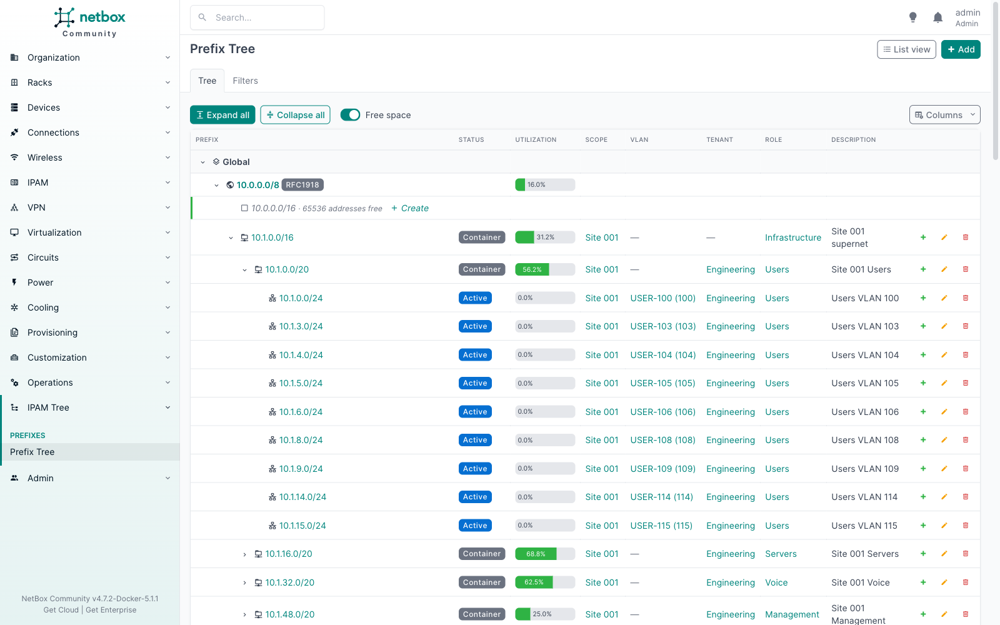
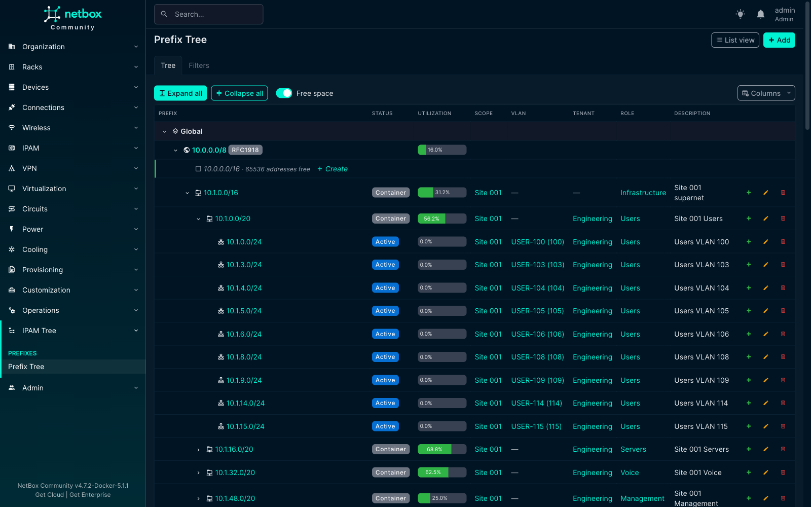

# netbox-ipam-treeview-plugin

netbox-ipam-treeview-plugin adds a DDI-style, collapsible tree view of NetBox IPAM. Instead of a flat, paginated list of prefixes, you start from the top-level supernets and drill down: **VRF → Aggregate → Prefix → child prefix**, with free space shown in place, one-click *Expand all* / *Collapse all*, and the tree remembering what you had open.



## Features

- **Collapsible tree**: roots are VRFs (Global first) and the aggregates holding their prefixes; children load lazily as you expand, so it stays fast on large IPAMs.
- **Expand all / Collapse all** for the whole tree or any subtree, capped by `expand_all_limit` so a click can never render an unbounded page.
- **Free space** between children, shown as greyed rows with a one-click *Create* that pre-fills the prefix and VRF.
- **Utilization bars** with the same numbers as NetBox's own prefix views, computed in bulk.
- **Row actions** (add child, edit, delete), shown only when you have the permission.
- **NetBox filters**: the native prefix filter form; matches are shown with their ancestors as greyed context.
- **Column picker**, saved per user.
- **Remembers state**: expanded nodes are restored when you come back.
- **Keyboard navigation** following the ARIA treegrid pattern.
- **Everywhere it is useful**: a *Prefix Tree* page, a *Tree view* button on the native prefix list (carrying your filters), and *Tree* tabs on Prefix, Aggregate and VRF pages. Each can be switched off.
- Light and dark themes.

The plugin adds no model and no database migration: it is a read-only view over NetBox's own prefixes, aggregates and VRFs.

## Quick start

Install the package into the NetBox virtual environment (see [Installation](installation.md)), then add this to `configuration.py`:

```python
PLUGINS = ["netbox_ipam_treeview"]
```

Run `collectstatic` and restart NetBox. The tree lives at `/plugins/ipam-tree/`, in the menu under *IPAM Tree → Prefix Tree* (or below *IPAM → Prefixes* with `menu_location = "ipam"`).

## Compatibility

| Plugin | NetBox | Python |
|---|---|---|
| next release | 4.7.2 to 4.7.x | 3.12, 3.13, 3.14 |
| 0.1.x | 4.7.0 to 4.7.x | 3.12, 3.13, 3.14 |

Every release is listed in [Installation → Compatibility](installation.md#compatibility).


