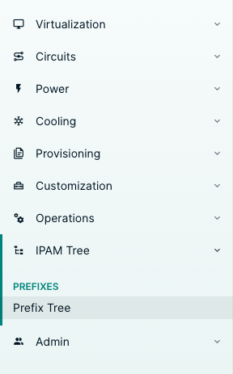
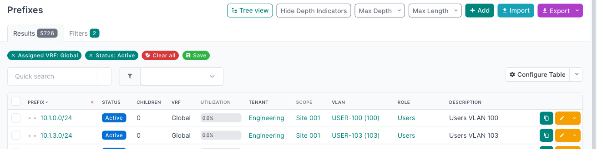
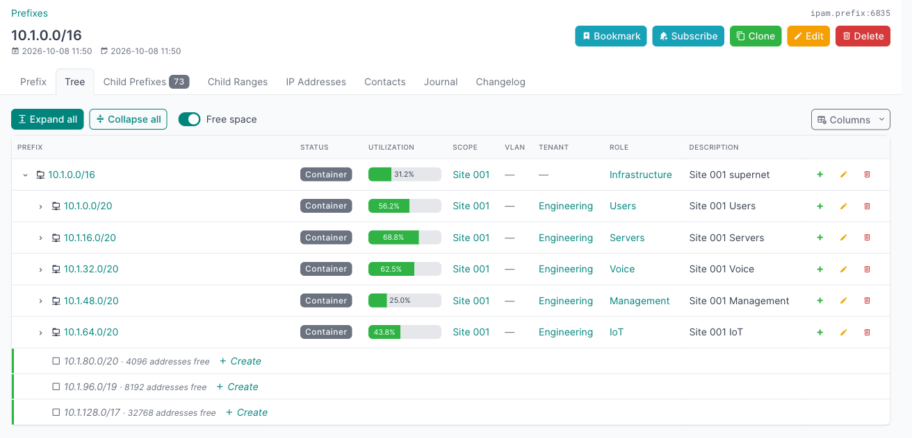
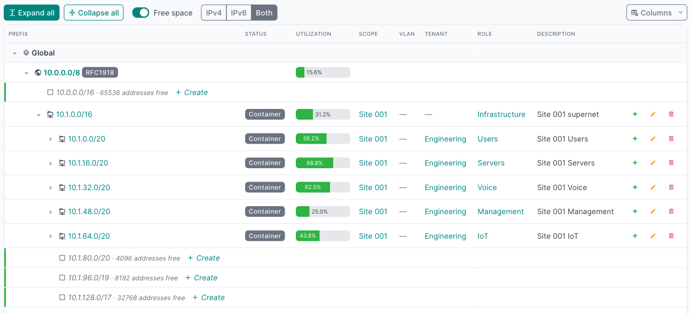
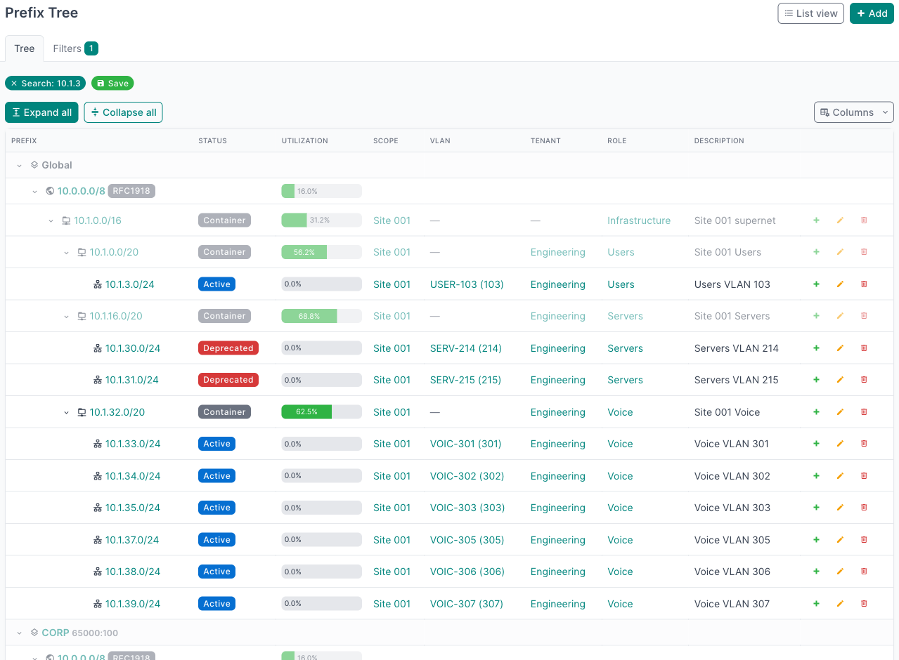
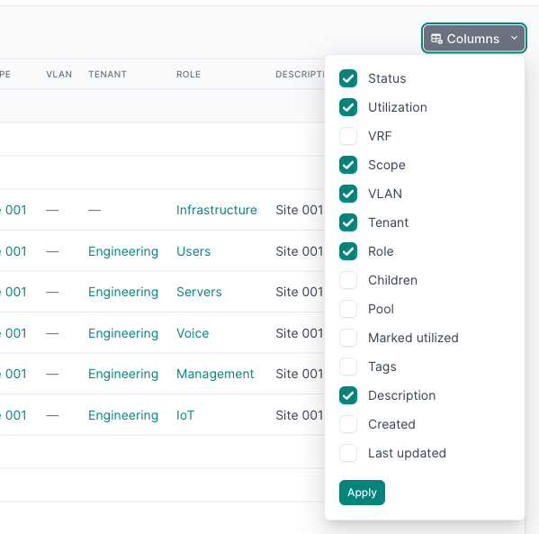

# Using the tree

## Where to find it

| Entry point | What it shows |
|---|---|
| *IPAM Tree → Prefix Tree* (`/plugins/ipam-tree/`) | The whole IPAM, one node per VRF (Global first). |
| *Tree view* button on the native prefix list | The same page, carrying the list's filters. Paging and sorting parameters are dropped. |
| *Tree* tab on a prefix | That prefix and the subtree below it. |
| *Tree* tab on an aggregate | That aggregate and the prefixes it covers. |
| *Tree* tab on a VRF | That VRF's prefixes. |

By default the page has its own *IPAM Tree* menu; `menu_location` moves the entry to the Plugins menu or right below
*IPAM → Prefixes* (see [Configuration](configuration.md#where-the-tree-appears)).

The *Tree view* button on the prefix list opens the tree with the list's filters applied:

The *Tree* tab on a prefix shows that prefix and its children, with free space:

## Levels

The tree reads **VRF → Aggregate → Prefix → child prefix**:

- **VRFs** are the top level (with `group_by_vrf`). Global, the prefixes with no VRF, comes first.
- **Aggregates** have no VRF in NetBox. Under each VRF group, an aggregate is shown if it covers that VRF's top-level prefixes.
- **Prefixes** nest by CIDR containment within their VRF, the same way NetBox's own prefix hierarchy works.

## Expanding and collapsing

- Click a caret to open or close one row. Children are fetched when the row is first opened.
- **Alt+click** a caret to open the whole subtree below it.
- *Expand all* and *Collapse all* in the toolbar act on the whole tree.

*Expand all* and subtree expansion stop at `expand_all_limit` rows (5000 by default). On a large IPAM, open a narrower subtree or use a filter instead.

## Free space

Free-space rows show the unallocated blocks between a node's children, as the largest CIDR blocks that fit. Each has a *Create* link that opens NetBox's prefix form with the prefix and VRF already filled in.

- The toolbar switch turns free-space rows on or off; the choice is remembered in the browser.
- Under pools and prefixes marked *utilized*, no free space is shown (`gaps_respect_mark_utilized`).
- Under a global container, prefixes from VRFs also count as used space, as in NetBox's own child-prefix view.
- A node shows at most `max_gap_rows` free-space rows; the rest are summarised in one row.

## Filters

The filter panel is NetBox's own prefix filter form. With a filter applied, the tree shows the matching prefixes plus their ancestors, greyed out, so you can see where each match sits. Filtered trees are capped by `expand_all_limit`.

Here a search for `10.1.3` shows the matching prefixes in both the Global table and the CORP VRF, with their ancestors
greyed out:

## Columns

The column picker in the toolbar chooses which columns to show and is saved in your NetBox user preferences.

Available columns:

| Key | Column |
|---|---|
| `status` | Status |
| `utilization` | Utilization bar |
| `vrf` | VRF |
| `scope` | Scope (site, region, location...) |
| `vlan` | VLAN |
| `tenant` | Tenant |
| `role` | Role |
| `children` | Number of child prefixes |
| `is_pool` | Pool |
| `mark_utilized` | Marked utilized |
| `tags` | Tags |
| `description` | Description |
| `created` | Created |
| `last_updated` | Last updated |
| `actions` | Add child, edit, delete |

Utilization uses the same rules as NetBox's prefix pages: a container counts its child prefixes, other prefixes count their IP addresses and ranges, and pools or prefixes marked utilized are full.

An aggregate's utilization is the share of it covered by prefixes. Under a VRF group, only that VRF's prefixes count (the global table's under *Global*), so the same aggregate can show a different value in each group, and so can its rows in the aggregate's *Tree* tab. Without `group_by_vrf`, the aggregate counts the prefixes of every VRF, the number NetBox shows on the aggregate's own page. For a user whose prefix view permission is constrained, aggregates count only the prefixes that user can see.

## Remembered state

The page remembers which nodes were open, in the browser's local storage, and reopens them when you come back. After *Expand all*, it remembers that instead and expands everything again (still within `expand_all_limit`).

Each *Tree* tab remembers its own open nodes, per prefix, aggregate or VRF, the same way. Until you open or close a node there, a tab starts with its object and its children open (an aggregate that spans several VRFs starts with one collapsed row per VRF).

The free-space switch is remembered in local storage and in an `ipam_tree_free` cookie, so pages and tabs are rendered with your choice from the start.

## Keyboard

Click a row or tab into the table, then:

| Key | Action |
|---|---|
| ↓ / ↑ | Next / previous visible row |
| → | Expand the row, or move to its first child if already open |
| ← | Collapse the row, or move to its parent if already closed |
| `*` | Expand the whole subtree |
| Enter | Open the row's object |
